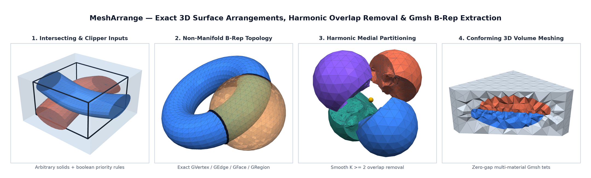
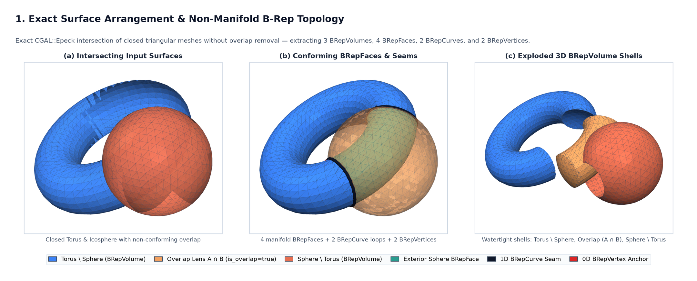
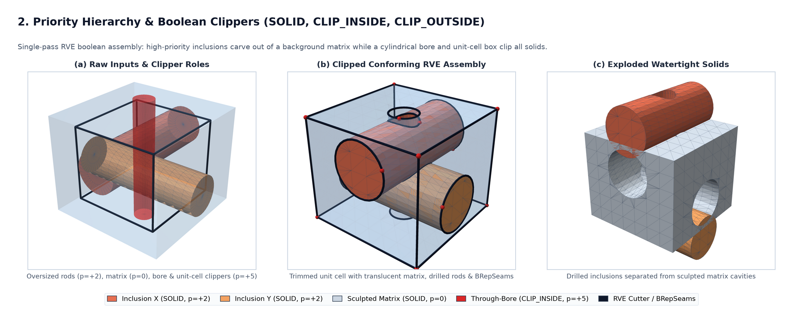
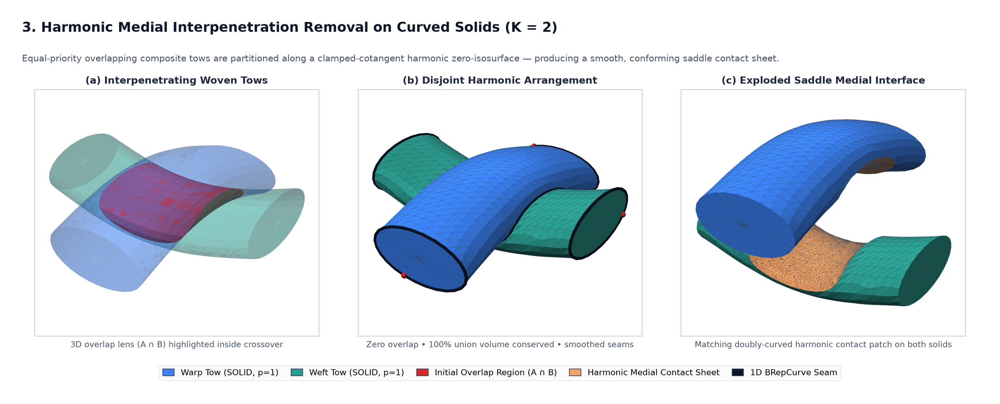
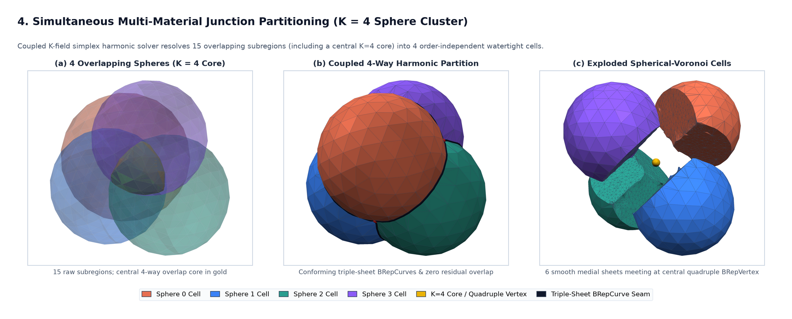
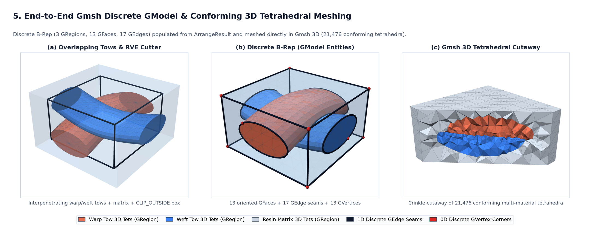

# MeshArrange

**MeshArrange** is a standalone C++17 library for computing conforming 3D surface arrangements from collections of watertight triangular meshes, extracting complete non-manifold B-Rep topology (3D regions, 2D region-boundary patches, 1D seam curves, and 0D corner/junction vertices), applying priority-based boolean clipping, and optionally resolving multi-material overlaps (`K >= 2`) along smooth harmonic medial surfaces. It is designed for zero-leakage integration into mesh generators such as **Gmsh** as well as multi-material finite-element preprocessing pipelines.



---

## Capabilities

- **Exact Surface Arrangement (`CGAL::Epeck`):** Resolves all pairwise and self-intersections across arbitrary collections of closed triangular surfaces while merging coplanar facets with priority-aware facet provenance.
- **Priority & Boolean Clipping Rules:** Supports `ObjectType::SOLID`, `ObjectType::CLIP_INSIDE` (holes/voids), and `ObjectType::CLIP_OUTSIDE` (domain bounding cutters) across arbitrary integer priority levels.
- **Topological Feature & B-Rep Extraction:** Segments volumetric 3D regions (`BRepVolume`), consistently oriented 2D surface patches (`BRepFace`), 1D non-manifold seam arcs (`BRepCurve`), and 0D junction/loop-anchor corners (`BRepVertex`) ready for `discreteVertex` / `discreteEdge` / `discreteFace` / `discreteRegion` construction in Gmsh.
- **Multi-Material Interpenetration Removal (`K >= 2`):** Partitions equal-priority overlapping solid regions using a simplex-normalized clamped-cotangent harmonic field, canonical conforming tetrahedral subdivision, and 2-manifold star repair so every surviving object has a strictly disjoint, watertight manifold boundary.
- **Zero-Leakage Pure-STL Public API:** Public headers (`#include "mesh_arrange/MeshArrange.h"`) expose only standard C++17 STL types (`std::vector`, `std::array`, `std::function`, `uint32_t`)—no Eigen, CGAL, libigl, or TetGen headers leak into consumer translation units.
- **Pluggable Coarse PLC Tetrahedralizer:** Includes an optional built-in namespaced TetGen backend (`MESHARRANGE_WITH_TETGEN=ON`, isolated inside `mesh_arrange::tetgen_internal` to avoid symbol collisions with global `::tetgenio`) and accepts any custom `PlcTetrahedralizerFn` callback (such as Gmsh's constrained 3D Delaunay/HXT mesher with `MESHARRANGE_WITH_TETGEN=OFF`).

---

## Visual Gallery & Demonstrations

All figures and downloadable VTK XML UnstructuredGrid (`.vtu`) meshes below are generated directly from the self-contained C++17 demo programs in [`examples/`](examples/). Every `.vtu` file in [`docs/meshes/`](docs/meshes/) can be downloaded and inspected interactively in **ParaView**, **PyVista**, or **Gmsh** (coloring or thresholding by `EntityDim`, `EntityTag`, `BRepVolumeID`, `OwnerObjectID`, `IsMedialSheet`, or `IsOverlap`).

### 1. Exact Surface Arrangement & Non-Manifold B-Rep Topology
*Source: [`examples/demo_brep_arrangement.cpp`](examples/demo_brep_arrangement.cpp) — Downloadable meshes: [`inputs.vtu`](docs/meshes/demo1_brep_arrangement_inputs.vtu) · [`brep.vtu`](docs/meshes/demo1_brep_arrangement_brep.vtu) · [`volumes.vtu`](docs/meshes/demo1_brep_arrangement_volumes.vtu)*

When `ArrangeOptions::remove_overlaps = false`, **MeshArrange** computes the exact (`CGAL::Epeck`) non-manifold arrangement of intersecting closed surfaces without discarding or merging overlap zones—decomposing space into watertight `BRepVolume` shells ($A \setminus B$, $A \cap B$, $B \setminus A$), consistently oriented `BRepFace` patches, 1D `BRepCurve` seam loops, and 0D `BRepVertex` anchors.



### 2. Priority Hierarchy & Boolean Domain Clipping
*Source: [`examples/demo_priority_clipping.cpp`](examples/demo_priority_clipping.cpp) — Downloadable meshes: [`inputs.vtu`](docs/meshes/demo2_priority_clipping_inputs.vtu) · [`brep.vtu`](docs/meshes/demo2_priority_clipping_brep.vtu) · [`volumes.vtu`](docs/meshes/demo2_priority_clipping_volumes.vtu)*

Representative Volume Element (RVE) and CAD assemblies often combine inclusions, background matrices, drilled bores, and bounding-box cutters. By assigning integer priorities alongside `ObjectType::SOLID`, `ObjectType::CLIP_INSIDE`, and `ObjectType::CLIP_OUTSIDE`, high-priority inclusions automatically carve cavities out of lower-priority matrix volumes while boolean clippers trim every object in a single exact pass.



### 3. Harmonic Medial Interpenetration Removal (`K = 2` Curved Solids)
*Source: [`examples/demo_harmonic_medial.cpp`](examples/demo_harmonic_medial.cpp) — Downloadable meshes: [`inputs.vtu`](docs/meshes/demo3_harmonic_medial_inputs.vtu) · [`before_volumes.vtu`](docs/meshes/demo3_harmonic_medial_before_volumes.vtu) · [`brep.vtu`](docs/meshes/demo3_harmonic_medial_brep.vtu) · [`volumes.vtu`](docs/meshes/demo3_harmonic_medial_volumes.vtu)*

Unlike boolean subtraction—which arbitrarily mutilates one solid while leaving the other rigid—**MeshArrange** resolves equal-priority interpenetrations (such as compacted woven composite tows or pressed soft tissues) by solving a clamped-cotangent Laplace boundary-value problem over each overlap zone and partitioning along the smooth zero-isosurface **harmonic medial sheet**, conserving 100% of the union volume.



### 4. Simultaneous Multi-Material Overlap Partitioning (`K = 4` Cluster)
*Source: [`examples/demo_multiway_junction.cpp`](examples/demo_multiway_junction.cpp) — Downloadable meshes: [`inputs.vtu`](docs/meshes/demo4_multiway_junction_inputs.vtu) · [`before_volumes.vtu`](docs/meshes/demo4_multiway_junction_before_volumes.vtu) · [`brep.vtu`](docs/meshes/demo4_multiway_junction_brep.vtu) · [`volumes.vtu`](docs/meshes/demo4_multiway_junction_volumes.vtu)*

When three or more equal-priority solids overlap at a common junction (`K >= 3`), sequential pairwise cuts fail due to order dependence and sliver gaps. **MeshArrange** solves a coupled $K$-field simplex-normalized harmonic system ($\sum_k u_k = 1$) whose $\arg\max_k u_k(\mathbf{x})$ partition resolves all 15 raw overlap subregions of four mutually intersecting spheres into 4 order-independent watertight cells meeting cleanly along 6 smooth medial sheets, 4 triple-junction curves, and 1 central quadruple `BRepVertex`.



### 5. End-to-End Gmsh Discrete `GModel` & Conforming 3D Tetrahedral Meshing
*Source: [`examples/demo_gmsh_rve_workflow.cpp`](examples/demo_gmsh_rve_workflow.cpp) — Downloadable meshes: [`inputs.vtu`](docs/meshes/demo5_gmsh_rve_inputs.vtu) · [`brep.vtu`](docs/meshes/demo5_gmsh_rve_brep.vtu) · [`volumes.vtu`](docs/meshes/demo5_gmsh_rve_volumes.vtu) · [`gmsh3d.vtu`](docs/meshes/demo5_gmsh_rve_gmsh3d.vtu)*

`ArrangeResult` maps directly onto Gmsh's discrete B-Rep entities (`discreteVertex`, `discreteEdge`, `discreteFace`, `discreteRegion`) via [`GmshModelBuilder.h`](include/mesh_arrange/GmshModelBuilder.h). Populating a Gmsh model from a woven composite RVE arrangement produces a zero-gap, multi-material conforming 3D tetrahedral mesh across both tows and the surrounding resin matrix.



---

## Project Structure

- `include/mesh_arrange/` — Public pure-STL C++17 headers (C++14-compatible for consumer translation units):
  - `MeshArrange.h` — High-level `arrange_surfaces(...)` API, `ArrangeOptions`, `ArrangeResult`, and B-Rep structs (`BRepVertex`, `BRepCurve`, `BRepFace`, `BRepVolume`).
  - `GmshSdkAdapter.h` — Header-only public Gmsh SDK adapter (`mesh_arrange::gmsh_sdk::arrange_surfaces`, `plc_tetrahedralizer`, `populate_arranged_model`) linking directly against `libgmsh` (`gmsh.h`) with **zero TetGen dependency**.
  - `GmshModelBuilder.h` — Header-only `populate_gmsh_discrete_model(...)` adapter for internal Gmsh `GModel` discrete entities.
  - `PlcBackend.h` — Pluggable `PlcTetrahedralizerFn` interface for custom coarse 3D PLC tetrahedralizers.
  - Modular pipeline headers (`CombinedSurfaces.h`, `ConsistentSurfaces.h`, `FeatureIdentification.h`, `InterpenetrationRemoval.h`, `Refinement.h`, `QualityTriangulation.h`, `Triangulation.h`, `Tetrahedralization.h`, `Seams.h`, `SplitEdges.h`, `Optimize.h`).
- `gmsh_upstream/` — Drop-in upstream Gmsh contribution bundle implementing **Option C**: `src/mesh/meshArrange.{h,cpp}`, `src/plugin/ArrangeSurfaces.{h,cpp}`, `api/gen.py` + `api/gmsh.cpp` bindings (`gmsh::model::mesh::arrangeSurfaces`), `CMakeLists_gmsh.cmake`, and `demos/arrange_surfaces.py`.
- `src/` — Library implementation and private geometry helpers.
- `examples/` — Self-contained C++17 capability demonstrations (writing standard `.vtu` meshes directly) and headless gallery renderer (`render_gallery.py`).
- `docs/images/` — Rendered demonstration figures displayed in this README.
- `docs/meshes/` — Downloadable `.vtu` (VTK XML UnstructuredGrid) input, B-Rep, and 3D tetrahedral volume meshes for all five demonstrations.
- `third_party/` — Vendored private header subset of `libigl` (`remesh_self_intersections`) and optional namespaced TetGen 1.6.
- `tests/` — CTest unit, regression, and live Gmsh SDK integration suites (`test_topology_and_seams`, `test_consistent_and_features`, `test_interpenetration_cases`, `test_custom_plc_and_gmsh_builder`, `test_gmsh_sdk_integration`).
- CMake package & target: `MeshArrange` / `MeshArrange::mesh_arrange`.

---

## Dependencies

All third-party mathematical dependencies are linked **`PRIVATE`** to `MeshArrange::mesh_arrange`:

- C++17 compiler (GCC 9+, Clang 10+, or MSVC 2019+) and CMake 3.16+
- [Eigen3](https://eigen.tuxfamily.org/) (>= 3.3)
- [CGAL](https://www.cgal.org/) (5.x+, header-only `CGAL::Epeck` exact predicates & constructions) with Boost headers; uses GMP (`libgmp`, `libgmpxx`) and MPFR (`libmpfr`) when available, or automatically falls back to header-only `Boost.Multiprecision`

---

## Quickstart Usage

```cpp
#include "mesh_arrange/MeshArrange.h"

std::vector<mesh_arrange::InputSurface> surfaces = { /* closed triangular meshes */ };

mesh_arrange::ArrangeOptions opts;
opts.remove_overlaps = true; // Partition equal-priority overlaps via harmonic medial sheets

mesh_arrange::ArrangeResult result = mesh_arrange::arrange_surfaces(surfaces, opts);
// result.brep_vertices, result.brep_curves, result.brep_faces, result.brep_volumes
// result.constituent_surfaces, result.exterior_boundary, result.surface_mesh
```

### Populating a Gmsh `GModel`

```cpp
#include "GModel.h"
#include "discreteVertex.h"
#include "discreteEdge.h"
#include "discreteFace.h"
#include "discreteRegion.h"
#include "MVertex.h"
#include "MLine.h"
#include "MTriangle.h"
#include "mesh_arrange/GmshModelBuilder.h"

auto result = mesh_arrange::arrange_surfaces(surfaces, opts);
mesh_arrange::populate_gmsh_discrete_model<
    GModel, discreteVertex, discreteEdge, discreteFace, discreteRegion,
    MVertex, MLine, MTriangle>(gmodel, result);
```

When embedding inside Gmsh without TetGen (`-DMESHARRANGE_WITH_TETGEN=OFF`), assign `opts.plc_tetrahedralizer` to a callback returning a coarse constrained tetrahedralization (`mesh_arrange::PlcTetOutput`) of the intersection-free `plc_surface`.

---

## Building, Tests & Demo Gallery

```bash
cmake -S . -B build -DCMAKE_BUILD_TYPE=Release \
  -DMESHARRANGE_BUILD_TESTS=ON -DMESHARRANGE_BUILD_EXAMPLES=ON
cmake --build build -j
ctest --test-dir build --output-on-failure
```

To build without the bundled TetGen backend and verify end-to-end 3D meshing against a Gmsh SDK installation (`-DMESHARRANGE_GMSH_ROOT=/path/to/gmsh`):

```bash
cmake -S . -B build-no-tetgen -DCMAKE_BUILD_TYPE=Release \
  -DMESHARRANGE_WITH_TETGEN=OFF -DMESHARRANGE_BUILD_TESTS=ON \
  -DMESHARRANGE_GMSH_ROOT=/path/to/gmsh
cmake --build build-no-tetgen -j
ctest --test-dir build-no-tetgen --output-on-failure
```

For contributing `mesh-arrange` directly into an upstream Gmsh source tree (`gmsh::model::mesh::arrangeSurfaces` + `Plugin(ArrangeSurfaces)`), see [`gmsh_upstream/README.md`](gmsh_upstream/README.md).

See [`examples/README.md`](examples/README.md) for instructions on running the individual demo executables and regenerating the figures in `docs/images/`.

---

## License & Public Release Information

Licensed under the **BSD 3-Clause License** (see [`LICENSE`](LICENSE) for full terms and third-party notices for `libigl` and optional `TetGen`).

Distribution Statement A. Approved for public release: distribution is unlimited. Case #: AFRL-2026-4513
